# DefectLens — Design Document

| | |
|---|---|
| Status | **Draft for review** — Phase 0 |
| Version | 0.1 |
| Date | 2026-10-04 |
| Author | Pavan Sai Kumar Dangeti |
| Decisions needing sign-off | [§16](#16-open-questions-for-review) |

---

## 1. Context

A quality engineer on a manufacturing line needs to decide, from a single photograph of a
part, whether to ship it or scrap it. Three facts about the real world make this hard:

1. **Defects are rare.** Typical defect rates are 0.1–1%. A classifier trained on labelled
   defects would need tens of thousands of defective examples per defect type that nobody has
   catalogued.
2. **Defects are varied and unknown in advance.** Scratch, dent, burr, void, contamination,
   missing feature — the list is open-ended and changes with process drift.
3. **Good parts are abundant.** The line produces millions of conforming parts, and they are
   already being inspected and discarded by whoever is doing it today.

This is the **one-class / novelty detection** setting. DefectLens learns a model of what
"normal" looks like for a given product category, from images of good parts only, and flags
anything that departs from that model.

The output a quality engineer actually acts on is a **decision**, not a score. So the system
must produce three things: an anomaly score, a heatmap localising the defect, and a
pass/fail verdict calibrated against a business constraint — "reject at most 1% of good
parts" — rather than against an arbitrary 0.5 cut.

### 1.1 The evaluation trap

MVTec AD is the field's standard benchmark, and it is also the field's most-quoted and most
mis-quoted source of numbers. During Phase 0 research I found that **the most commonly cited
configuration numbers for these methods do not reproduce under the most commonly used
reference implementation**, for two independent and mechanical reasons:

- anomalib's default pre-processing is `Resize(256)` with **no** centre crop, whereas the
  PatchCore and PaDiM papers both specify `Resize(256) → CenterCrop(224)`.
- anomalib's default PaDiM is **ResNet-18 with 100 random dimensions**, which is the
  localisation-only ablation in the PaDiM paper, not the 550-dim WideResNet-50 configuration
  that the 97.5 headline number comes from.

Consequently anomalib's own published PatchCore scores (0.980 image / 0.980 pixel AUROC) sit
below the paper's (0.991 / 0.981). Anyone comparing "my" number to "anomalib's" number is
comparing two different protocols. §5 fixes DefectLens's protocol explicitly and §6.4 requires
a parity test against anomalib **on the identical protocol** so that any residual gap is a
genuine implementation difference rather than a preprocessing artefact. Getting this right is
the single highest-leverage credibility decision in the project.

---

## 2. Goals and non-goals

### Goals

| # | Goal | Verified by |
|---|---|---|
| G1 | Image-level anomaly score, pixel-level heatmap, calibrated pass/fail per product category | AUROC + AUPRO + escape-rate-at-target-FRR |
| G2 | My own PatchCore implementation, verified against a reference implementation | Parity test vs anomalib on identical splits (§6.4) |
| G3 | Fast **CPU** inference suitable for edge deployment | Measured p50/p95 latency and RSS on stated hardware |
| G4 | Human review loop that feeds corrections back into the model | Simulated loop with held-out measurement (§6.8) |
| G5 | Monitoring that detects incoming images drifting from what the model learned | Drift metrics + alert thresholds (§6.9) |

### Non-goals

These are deliberate exclusions. Naming them prevents scope creep during implementation.

- **Defect classification** into named types. The output is "normal or not". Naming a defect
  requires a taxonomy the method cannot infer from unlabelled good data, and it is a
  supervised problem that a separate classifier should solve later.
- **Camera / hardware integration.** The system consumes images over HTTP. Line integration is
  a different project with different constraints (latency determinism, PLC signalling).
- **GPU-only serving.** The deployment target is a 2-core CPU VM, so the whole design is
  shaped by CPU inference cost. See §8.
- **Sub-1% false-reject claims on categories with insufficient calibration data.** See the
  statistical constraint in §6.5.

---

## 3. Requirements and SLOs

### 3.1 Service level objectives

Latency targets are stated against the **actual deployment target** — an Oracle Always Free
ARM VM with 2 OCPU / 12 GB (§8) — because an SLO against unspecified hardware is not an SLO.
All are measured on that hardware plus my Apple M5 (16 GB) for comparison.

| ID | Objective | Target | Stretch |
|---|---|---|---|
| SLO-1 | `/inspect` latency, single image, 2-core ARM VM, warm | p50 ≤ 400 ms, **p95 ≤ 1.5 s** | p95 ≤ 800 ms |
| SLO-2 | Batched throughput, batch 16, same host | ≥ 8 images/s | ≥ 15 images/s |
| SLO-3 | Peak resident memory, serving all demo categories | ≤ 2.0 GB RSS | ≤ 1.2 GB |
| SLO-4 | Memory bank on disk per category | ≤ 512 MB | ≤ 200 MB |
| SLO-5 | Cold start to first successful `/inspect` | ≤ 60 s | ≤ 20 s |
| SLO-6 | Availability of the public demo, monthly | ≥ 99% | ≥ 99.5% |
| SLO-7 | Parity with anomalib PatchCore, identical protocol | image AUROC within **1.0 pp**, pixel AUROC within 1.0 pp, AUPRO within 1.5 pp | 0.5 pp |

### 3.2 Model quality objectives

| ID | Objective |
|---|---|
| QO-1 | Mean image AUROC on MVTec AD (15 cat) at or above the PatchCore paper's 0.991, within the parity tolerance of SLO-7 |
| QO-2 | Mean AUPRO on MVTec AD ≥ 0.930 (paper reports 0.934 at 25% coreset, 0.935 at 10%) |
| QO-3 | Generalisation to VisA **without retuning**: report per-category, and treat a drop below the MVTec result as an expected finding, not a failure |
| QO-4 | At target FRR = 1%, report escape rate per category with a binomial confidence interval. No threshold on a category whose calibration set is too small to support the target (§6.5) |

### 3.3 Correctness and safety requirements

| ID | Requirement |
|---|---|
| CR-1 | No input may ever produce a **silent wrong pass**. Invalid input yields a 4xx with a specific error; in-distribution-but-unusual input yields a decision with an explicit low-confidence / out-of-distribution flag. Enforced by the failure test suite (§15). |
| CR-2 | Every model artefact is checksum-verified against a versioned manifest before load. A mismatch fails `/ready`; it never falls back to an unverified artefact. |
| CR-3 | Decision thresholds are calibrated **only** on images disjoint from both the fitting set and the test set. Enforced structurally: the calibration split is created by the data loader, not by the caller. |

---

## 4. Data

### 4.1 Datasets

| | MVTec AD | VisA |
|---|---|---|
| Publisher | MVTec Software GmbH | Amazon (`visualanomaly` team) |
| Categories | 15 (5 textures, 10 objects) | 12 |
| Nominal train images | 3,629 total | ~8,659 total |
| Test anomalous | 467 | 1,200 (100 per category) |
| Ground truth | Binary pixel masks | **Multi-class `uint8` masks**, values 1–9 encode defect type |
| Access | Registration form, including a non-commercial-use acknowledgement | Direct download, no registration |

Two dataset-specific traps that will silently corrupt results if ignored:

1. **VisA masks are multi-class.** Pixel-level metrics require binary masks; defect-type
   channel values must be binarised (`> 0`). Passing the raw `uint8` straight to a binary
   metric produces plausible-looking wrong numbers.
2. **Image geometry is not square.** MVTec AD images are square. VisA images are not, and a
   `Resize(256)` in the common torchvision idiom resizes the **shorter edge**, which then gets
   centre-cropped — silently discarding up to ~46% of the image width on the widest VisA
   categories. DefectLens therefore resizes to a fixed `(256, 256)` tensor
   (`Resize((256, 256))`, aspect-distorting) and states this explicitly in the config, rather
   than inheriting an accidental crop. The trade-off is geometric distortion; the benefit is
   that no part of the part is ever cropped out of frame before the model sees it. For a
   defect that can occur anywhere in the frame, cropping is the worse failure.

### 4.2 Licences — verified, and the resulting decision

I verified both licences against primary sources rather than secondary summaries, because
this determines what DefectLens is allowed to ship.

**MVTec AD — CC BY-NC-SA 4.0, non-commercial.** Verified 2026-10-04 on MVTec's own dataset
page, which states:

> "The data is released under the Creative Commons Attribution-NonCommercial-ShareAlike 4.0
> International License (CC BY-NC-SA 4.0). In particular, it is not allowed to use the
> dataset for commercial purposes. If you are unsure whether or not your application violates
> the non-commercial use clause of the license, please contact us."

The ShareAlike clause raises a question the licence text does not answer: **does a trained
model, or the feature memory bank derived from these images, count as "Adapted Material"?**
If it does, the derived weights may inherit a ShareAlike obligation. MVTec publishes no
position on this. I am not going to guess at a legal conclusion.

**VisA — CC BY 4.0, commercially usable.** Verified two ways: the tarball's `LICENSE-DATASET`
file is byte-identical (SHA-256) to the canonical Creative Commons CC BY 4.0 legal code with
zero added restrictions, and it ships inside the tarball itself. The repository's root
`LICENSE` is Apache-2.0, but that governs **code only** — a distinction that is easy to miss
and that at least one widely-used library gets wrong (anomalib's dataset metadata lists VisA
as CC BY-NC-SA 4.0, which contradicts Amazon's own terms and is more restrictive than the
actual licence).

**Decision (ADR-0001, approved):** MVTec AD is used as a **research benchmark only**. Its full
15-category results are reported, because it is the field's standard and any reviewer will
expect them, but no MVTec-derived artefact ships. The model served by the public demo is
trained on VisA, which is licence-clean. This gives a standard benchmark *and* a legally
unencumbered product path, and it is why the two datasets are not interchangeable in this
project.

An open item for the owner: if DefectLens ever needs to ship an MVTec-derived model for
commercial use, that requires either a direct licence from MVTec or written confirmation that
the artefacts are not Adapted Material. §16.

### 4.3 Splits and leakage prevention

Leakage is the most common way an anomaly-detection benchmark produces a number that means
nothing, so the split policy is structural rather than advisory.

For each category, the nominal (good) training images are split **once, deterministically, by a
seeded permutation** into:

| Split | Purpose | Fraction |
|---|---|---|
| `fit` | Builds the memory bank / Gaussian parameters | 80% |
| `calibration` | Chooses the decision threshold | 10% |
| `holdout` | Reports an unbiased estimate of the achieved false-reject rate | 10% |

The published test set (nominal + anomalous, never used for fitting) is evaluated **once**,
at the end, with the threshold already frozen. The `holdout` split exists because the
calibration set is itself used to pick the threshold, so the false-reject rate measured on
`calibration` is optimistic; `holdout` gives the honest number.

Few-shot experiments draw their `n` images from `fit` **only**, so a few-shot model and its
calibration set never overlap.

---

## 5. Evaluation protocol

This section is normative. Every number in the README must be produced under this protocol,
and CI fails if a README figure drifts from the committed result file it cites (§14).

### 5.1 Pre-processing

| Step | Value | Source |
|---|---|---|
| Resize | `(256, 256)` — explicit both-axes resize | DefectLens decision (§4.1) |
| Centre crop | `224 × 224` | PatchCore §4.1 and PaDiM §IV-B both specify 256 → 224 |
| Normalisation | ImageNet mean `[0.485, 0.456, 0.406]`, std `[0.229, 0.224, 0.225]` | anomalib source; not stated in either paper |
| Augmentation | **None** | PatchCore §4.1: "No data augmentation is applied, as this requires prior knowledge about class-retaining augmentations" |

Anomalib's default of `Resize(256)` with **no** crop is deliberately *not* followed, because
the papers' numbers are the ones I need to compare against. §6.4 handles the comparison
properly by running both implementations under this one protocol.

### 5.2 Score map post-processing

Both papers upsample the patch-level score map back to input resolution and smooth it.
PatchCore uses bilinear interpolation with a Gaussian of σ = 4; PaDiM uses bicubic with σ = 4.
DefectLens uses **bilinear + Gaussian σ = 4** for both models and treats σ as a config knob,
because holding post-processing identical across models removes one variable from the
model-vs-model comparison.

Pixel metrics are computed against ground truth at the **network input resolution (224×224)**
after the same resize, not at the original image resolution. This matches anomalib's
behaviour and avoids an interpolation-order confound between the score map and the mask.

### 5.3 Metrics

| Metric | Definition | Integration range |
|---|---|---|
| **Image AUROC** | AUROC of the scalar image score over the test set | — |
| **Pixel AUROC** | AUROC over all pixels, image-pooled within a category | — |
| **AUPRO** | Per-region overlap curve, area integrated and normalised | **FPR ≤ 0.3** |
| **Escape rate @ FRR** | FN rate on anomalous test images at the threshold meeting the target FRR | — |

Two clarifications that matter:

- **AUPRO's correct citation is Bergmann et al., "Uninformed Students", CVPR 2020** — which
  defines integration "until an average per-pixel false-positive rate of 30% for the entire
  dataset is reached", with the integrated area normalised to 1. The MVTec AD 2019 paper
  reports per-region overlap **at a single threshold** and does not define the integrated
  curve. anomalib's `AUPRO` (default `fpr_limit=0.3`) is this same metric under a different
  name. These are one metric, not two, and must never be compared against each other as if
  they were independent evidence.
- **Averaging is class-averaged, not pixel-pooled.** The mean of 15 per-category AUROs, not
  one AUROC over all pixels of all categories. Pixel-pooling inflates results on large
  categories and is not comparable to published numbers.

### 5.4 Reference numbers to compare against

All verified against primary sources (§17). These are the targets, not results — DefectLens's
own numbers come from committed scripts.

MVTec AD, single-class, class-averaged, 256 → 224 centre crop:

| Method | Image AUROC | Pixel AUROC | PRO/AUPRO |
|---|---|---|---|
| PaDiM (WR50, Rd550) | 0.953 | 0.975 | 0.921 |
| PaDiM (EfficientNet-B5, per-category backbone selection) | 0.979 | — | — |
| **PatchCore (WRN50, 2+3, 25% coreset)** | **0.991** | **0.981** | **0.934** |
| PatchCore (WRN50, 2+3, 10% coreset) | 0.990 | 0.981 | 0.935 |
| PatchCore (WRN50, 2+3, 1% coreset) | 0.990 | 0.980 | 0.931 |

The 0.979 PaDiM figure is **not** comparable to the others: it comes from choosing a different
backbone per category, and the PatchCore authors state they could not reproduce it. It is
recorded here so that nobody quotes it as if it were a like-for-like result.

VisA, 1-class protocol (90% nominal train / 10% nominal + all anomalies test):

| Source | Image AUROC | Pixel AUROC | AU-PRO |
|---|---|---|---|
| PatchCore, anomalib reproduction (Real-IAD Table 2, §5.1; verified against the paper) | 0.951 | — | 0.912 |
| DefectLens PatchCore, 12-category mean, 3 seeds, coreset 0.01 (`results/evaluation/summary.json`) | 0.891 | 0.954 | 0.736 |

Earlier drafts of this table also quoted PaDiM and PatchCore VisA figures from other papers. Those
could not be traced to a source, so they were removed. The README's reference comparison lists the
protocol differences between the Real-IAD row and our measurements.

**The most important number in this document:** on our own runs, PatchCore's mean image AUROC is
0.967 on MVTec AD (15 categories) and 0.891 on VisA (12 categories). VisA is a harder, more realistic
benchmark — multiple instances per image, cluttered structure, and only 100 anomalies per
category. **A MVTec-only evaluation materially overstates what this method does on a real
line.** VisA is therefore the primary generalisation evidence and the licence-clean serving
path, not an afterthought.

### 5.5 Variance and confidence

- Few-shot curves use **5 seeds** and report mean ± 95% CI (1.96 × standard error). The
  PatchCore paper's own few-shot figures vary by ±0.4 to ±1.0 pp, so single-seed few-shot
  numbers are not interpretable.
- AUROC confidence intervals come from **bootstrap resampling** of the test set, 1,000
  resamples, fixed seed.
- Escape rate CIs are **Wilson** intervals on the binomial, which is the right choice at small
  positive rates where the normal approximation breaks down.
- PaDiM involves random dimension selection and PatchCore involves random coreset seeding, so
  both get multiple seeds and a reported spread. A single-seed comparison between them is not
  evidence.

---

## 6. Design

### 6.1 Overview

```mermaid
flowchart LR
    subgraph ingest["Ingest"]
        IMG[Image bytes] --> VAL[Validate: size, dims, decode]
        VAL --> PRE[Pre-process: resize/crop/normalise]
    end
    subgraph features["Feature extraction"]
        PRE --> BB[Backbone<br/>WideResNet-50 or ResNet-18<br/>ONNX + INT8]
        BB --> AGG[Local neighbourhood aggregation<br/>adaptive avg pool, p=3]
        AGG --> PATCH["Patch features<br/>980 x D"]
    end
    subgraph models["Models"]
        PATCH --> PC[PatchCore<br/>coreset memory bank<br/>FAISS kNN]
        PATCH --> PD[PaDiM baseline<br/>per-position Gaussian<br/>Mahalanobis]
        PC --> MAP[Score map: bilinear upsample + Gaussian sigma=4]
        PD --> MAP
    end
    subgraph decision["Decision"]
        MAP --> SCORE[Image score: max of reweighted map]
        SCORE --> THR{Threshold tau_c<br/>from calibration split}
        THR -->|below| PASS[pass]
        THR -->|above| FLAG[flag for review]
        MAP --> OOD[Input drift check]
        OOD --> CONF[low-confidence flag]
    end
    subgraph ops["Operations"]
        FLAG --> QUEUE[(Review queue)]
        QUEUE --> LOOP[Confirmed good -> memory bank<br/>Recalibrate tau_c, versioned]
        LOOP --> REG[(Model registry<br/>+ MLflow)]
        REG --> SERVE[FastAPI /inspect]
        SERVE --> PROM[Prometheus metrics<br/>+ drift dashboard]
    end
```

### 6.2 Feature extraction

A frozen ImageNet-pretrained backbone, no fine-tuning. This is deliberate: PatchCore's
entire claim is that **no training is required**, which is what makes it viable for a new
product line where you have tens of good images and no defects at all.

Mid-level features from two layers, with local neighbourhood aggregation by adaptive average
pooling over a `p × p` window with stride 1. PatchCore's ablation found a clear optimum at
**p = 3**.

**Backbone selection is measured, not assumed** (ADR-0005). Candidates:

| Backbone | layer2 + layer3 dims | Patch dim | Relative CPU cost |
|---|---|---|---|
| ResNet-18 | 128 + 256 | 384 | ~1× |
| WideResNet-50-2 | 512 + 1024 | 1536 | ~4× |
| EfficientNet-B5 | — | — | ~5× |

For reference, PatchCore's own backbone ablation found "results are mostly stable over the
choice of different backbones" — ResNet-50 and WideResNet-50 land within ~0.1–0.3 pp image
AUROC of each other. anomalib's published numbers show ResNet-18 at 0.973/0.976 versus
WideResNet-50 at 0.980/0.980 image/pixel AUROC — a real but small ~0.7 pp image gap for
roughly 4× less compute.

The deployment target has 2 cores, so if ResNet-18 costs ~0.7 pp image AUROC and buys 4× the
latency headroom, that is a trade worth measuring and probably worth taking for the edge
configuration. Both are implemented; Phase 3 measures the curve and Phase 4 recommends one
production configuration with the numbers attached.

### 6.3 PaDiM — baseline

Per-patch-position multivariate Gaussian. For each spatial position *p*, fit mean μ_p and
covariance Σ_p over all nominal training embeddings at that position; score a query patch by
its Mahalanobis distance to that position's Gaussian.

Implementation details that matter:

- **Random dimensionality reduction** to 550 dims (WR50) or 100 dims (R18), selected with a
  seeded RNG. This is not just speed: the PaDiM paper's own ablation shows random selection
  beating PCA at equal dimension (96.7 vs 93.5 pixel AUROC at 100 dims), because it preserves
  the full per-dimension variance structure that the Gaussian model depends on.
- **Covariance regularisation ε = 0.01** added to the diagonal. Without it, Σ_p is singular
  whenever the number of training images is below the feature dimension — which is exactly
  the few-shot regime this project cares about.
- Image score is the **max** of the anomaly map.
- Bicubic score-map upsampling, Gaussian σ = 4, matching the paper.

PaDiM earns its place as the baseline for two reasons: it is the method most directly
comparable to PatchCore (same features, same protocol, one structural difference — a
parametric per-position model versus a non-parametric memory bank), and it is roughly an
order of magnitude cheaper, so it bounds the "is the memory bank worth it?" question.

### 6.4 PatchCore — primary method

Implemented from the paper, not from a library.

**Fitting** is training-free:

1. Extract patch features for every nominal training image → memory bank `M` of shape
   `(N_patches_total, D)`.
2. **Greedy k-center coreset subsampling.** Start from a random seed vector; repeatedly add the
   bank vector farthest from the already-selected set, until the target ratio is reached. This
   is the mechanism that reduces redundancy in the bank, cutting both storage and inference
   cost. Targets: 1%, 10%, 25%, 100%.
3. Index the coreset with FAISS for exact (or quantised) nearest-neighbour search.

**Scoring** a query image:

1. Extract its patch features, same pipeline as fitting.
2. For each patch, find the distance to its nearest coreset vector → raw patch anomaly scores.
3. **Reweight** the image score by the neighbourhood of the nearest matching bank vector: a
   patch that matches a bank location whose own nearest neighbours are far away is more
   suspicious than one sitting in a densely populated region of the bank. The reweighting uses
   the `b` nearest bank vectors (anomalib's default `b = 9`); the paper states it
   symbolically and does not give a number.
4. Assemble the score map in patch-grid order, bilinear-upsample to 224×224, Gaussian σ = 4.
5. Image score = max of the reweighted map.

**Verification against anomalib is a hard gate, not a nice-to-have** (SLO-7). anomalib 2.6.2's
documented defaults are `backbone='wide_resnet50_2'`, `layers=('layer2','layer3')`,
`coreset_sampling_ratio=0.1`, `num_neighbors=9`, Gaussian σ = 4, ImageNet normalisation. Phase 2
runs anomalib under **this document's protocol** — explicitly setting its centre crop — and
compares image AUROC, pixel AUROC and AUPRO per category. Tolerance is 1.0 / 1.0 / 1.5 pp.

If my implementation and anomalib disagree, the cause is diagnosed and written down, not
papered over. The candidate causes are known in advance and each has a different severity:
coreset sampling implementation (mine may differ — this is expected and must be explained),
pre-processing mismatch (a bug on my side), neighbourhood aggregation, or reweighting formula.
**Any gap above tolerance blocks the release**, because the whole point of the parity check is
to distinguish "my method" from "my bug".

The published coreset sensitivity is encouraging: 1%, 10% and 25% coresets differ by ~0.1 pp
image AUROC. If that holds here, coreset ratio is close to a free memory/latency knob.

### 6.5 Decision layer

AUROC is threshold-free and therefore not actionable. The business constraint is one-sided:
**rejecting a good part costs money; shipping a defective part costs more.** So thresholds are
set from the good side.

For category *c* and target false-reject rate `f`:

1. Score every image in the `calibration` split.
2. Set `τ_c` to the `f`-quantile of those scores (equivalently, the `(1-f)`-quantile of the
   good-score distribution), so at most `f` of good parts are rejected.
3. Freeze `τ_c`. Evaluate the published test set once. Report escape rate = fraction of
   anomalous test images scoring below `τ_c`.

**The statistical constraint, stated plainly:** to claim "FRR ≤ 1%" you need a calibration set
large enough to estimate the 99th percentile. With ~240 nominal training images per MVTec
category, a 10% calibration split is ~24 images — the 99th percentile of 24 samples is not
meaningfully estimable, and the achieved FRR will have a wide interval. Categories with fewer
nominal images get a **larger calibration fraction**, and where the calibration set cannot
support the requested target, DefectLens **reports the widest target it can support and says
so** rather than printing a confident 1%.

This is the kind of thing that separates a real production system from a benchmark script, and
it is called out here because it changes what Phase 3 can legitimately claim.

### 6.6 Optimisation

| Technique | Scope | Expected effect |
|---|---|---|
| ONNX export | Backbone only | Faster CPU inference, framework-independent serving |
| INT8 static quantisation | Backbone, with a calibration set drawn from nominal training images | ~2–3× CPU throughput, small accuracy delta to be measured |
| Coreset ratio | Memory bank | 1–25% of the full bank; published cost is ~0.1 pp AUROC |
| FAISS product quantisation | Memory bank index | Sub-linear search; **required, not optional, for SLO-1** |

**Why IVF-PQ is mandatory rather than a nice extra.** A rough cost estimate for one category
(~240 nominal images, ~980 patches each, D = 1536): the memory bank holds ~235k vectors, and a
single query image has ~980 patch queries. Exhaustive L2 search is
980 × 235k × 1536 ≈ **3.5 × 10¹¹ multiply-accumulates per image**. On 2 ARM cores that is
seconds per image — SLO-1 is unreachable with a flat index. With an IVF index at `nprobe ≈ 8`
of ~1024 lists, only ~0.8% of the bank is touched, a ~125× reduction, which brings it inside
budget. Product quantisation then shortens each distance computation by roughly the
compression ratio.

The consequence for the design is that **PQ quality is a first-class accuracy parameter**, not
just a memory optimisation, and Phase 4 measures accuracy against PQ configuration on the same
axes as everything else. The published reference also shows IVF-PQ is survivable
accuracy-wise: PatchCore-100% + IVFPQ reports 0.980/0.979/0.930 versus 0.991/0.981/0.934 for
the full exact index — roughly 1 pp of image AUROC for a large latency and memory win.

Quantisation applies to the **backbone only**. The memory bank is compressed by coreset
selection and PQ, not by integer quantisation of features, because the nearest-neighbour
search is exactly the operation where precision loss turns directly into recall loss.

### 6.7 Serving

FastAPI, single container.

| Endpoint | Purpose |
|---|---|
| `POST /inspect` | image → score, decision, heatmap PNG, model version, latency |
| `POST /inspect/batch` | many images → array of results |
| `GET /ready` | **503 if no model is loaded or artefacts fail checksum** |
| `GET /health` | liveness; does not check model state |
| `GET /metrics` | Prometheus exposition |
| `GET /review/queue`, `POST /review/{id}` | review loop (§6.8) |

Model artefacts load from a registry at startup. `/ready` returning 503 until a model is
loaded is what makes the load balancer and the CI smoke test meaningful — a service that
accepts traffic it cannot serve is worse than one that refuses it.

### 6.8 Review loop

Flagged images enter a review queue. A reviewer marks each **true defect** or **false alarm**.

- **False alarm** → the image is confirmed nominal, so it is a legitimate new nominal
  observation. It is added to the memory bank on the next versioned rebuild.
- **True defect** → retained as a regression fixture: any future model must still flag it.

Thresholds are recalibrated by a **versioned job**, not inline. Every rebuild produces a new
model version with its own manifest, metrics, and model card; the previous version stays
loadable so a bad rebuild can be rolled back by changing one version pointer.

**Measurement.** The loop's value is measured with a simulated review loop, and this is the
subtle part: the simulation must use a **held-out slice of nominal images never seen during
fitting or calibration**, injected as if a reviewer had confirmed them, measuring the change in
escape rate at fixed FRR. Evaluating the loop on images already used for fitting would measure
nothing — the model has already memorised them.

Security note: this loop is a poisoning vector and is treated as one in §9 (T9).

### 6.9 Monitoring

| Signal | Method | Alert |
|---|---|---|
| Input drift | Image statistics (mean, std, per-channel histogram distance) **and** feature-distribution distance from the training set via **MMD** on a held-out reference embedding sample | MMD above threshold calibrated on held-out nominal validation data |
| Score drift | Distribution distance of anomaly scores vs the calibration distribution (Kolmogorov–Smirnov / PSI) | Sustained shift over a window |
| Decision rate | Fraction of parts flagged | Alert on rate outside the historical band |

The MMD reference sample is drawn from **held-out nominal images**, so the alert threshold
means "further from our own nominal data than our own held-out nominal data is" — a baseline
that is honest about natural variation, rather than an arbitrary constant.

Exported as Prometheus metrics; dashboard definitions are committed (§12).

### 6.10 MLOps

- **Versioned data manifests** with per-file checksums; every run records the manifest hash,
  so a result file is always traceable to the exact data that produced it.
- **YAML configs** for every run; the resolved config is hashed into the MLflow run.
- **MLflow** tracking with a **local file-backed model registry**.
- A **training CLI** (`defectlens train|evaluate|optimise|serve`) so every number in the
  README is produced by a command someone else can type.
- **Model card per category**, generated from measured results — not written by hand.
- **CI smoke run** on one small category, which must complete inside the pull-request budget.

---

## 7. Alternatives considered

### 7.1 Method

| Alternative | Why not |
|---|---|
| **PaDiM as the primary method** | Cheaper and simpler, but its VisA gap to PatchCore has not been measured in this repository, and the published figures we quoted earlier could not be verified. Demoted to baseline, where it is genuinely useful — it bounds the value of the memory bank. |
| **Student–teacher (Uninformed Students)** | Requires training a student per category, which contradicts the few-shot cold-start premise and multiplies CI and serving cost. |
| **Reconstruction / inpainting (DRAEM, RIAD)** | Superficial-anomaly bias: they can reconstruct a defect from context. Strong on textures, weak on the structural subtleties that matter for objects. |
| **Normalising flows (FastFlow, CFLOW)** | Better published MVTec numbers than PatchCore, but requires per-category training, which is exactly what the deployment scenario cannot afford. |
| **Foundation models (WinCLIP, UniAD, AnomalyCLIP)** | Genuinely interesting zero-shot route and the right long-term direction. Rejected for this project on three grounds: multi-GB weights are hostile to a 2-core CPU SLO; zero-shot does not benefit from the customer's own good images, which is the data we actually have; and the brief's premise is memory-bank learning. Worth revisiting if a small distilled variant appears. |
| **Per-defect-type classification** | Explicit non-goal (§2). |

### 7.2 Protocol alternatives

| Alternative | Why not |
|---|---|
| Follow anomalib defaults (`Resize(256)`, no crop) | Simpler, but makes every comparison to the papers apples-to-oranges and hides the very gap the parity test is meant to find. |
| Evaluate pixel metrics at original image resolution | Cleaner conceptually, but introduces an interpolation-order confound between score map and mask, and diverges from both anomalib and the papers. |

### 7.3 Feature extraction

| Alternative | Why not |
|---|---|
| Fine-tuning the backbone per category | Contradicts the no-training premise; with 1–10 nominal images it would overfit immediately. |
| DINOv2 / self-supervised ViT features | Reported strong on MVTec, and a legitimate Phase 7 candidate. Deferred: adds a second large dependency and its own CPU cost profile before the core trade-off is measured. Noted, not dismissed. |

---

## 8. Hosting plan

The brief suggested Hugging Face Spaces on free CPU. **That option no longer exists.**
Verified on Hugging Face's own documentation, 2026-10-04:

> "Static Spaces are free for everyone. Gradio and Docker Spaces run on compute and require a
> paid plan to create: PRO for personal accounts, Team or Enterprise for organizations. Free
> personal accounts in good standing can still host up to 2 Gradio Spaces running on ZeroGPU."

CPU Basic is still listed as `FREE` in the hardware table, but that price is unreachable for a
new compute Space; the free allowance is now 2 ZeroGPU (GPU) Gradio Spaces, and this project
needs CPU. Using it as stated would cost $9/month, which breaks the $0 budget.

### 8.1 Options assessed

| Option | Verdict |
|---|---|
| **Oracle Cloud Always Free VM** — 2 ARM OCPU / 12 GB RAM / 200 GB disk / 10 TB egress/month | **Selected** |
| Render free web service | 0.1 CPU / 512 MB. Cannot hold the model; ephemeral disk; no workers; 15-min spin-down. Rejected on memory. |
| Vercel / Netlify Hobby | 4.5 MB request payload cap blocks industrial images; 4 hours active CPU/month; no persistent process. Rejected. |
| HF Spaces PRO ($9/mo) | Would work, but costs money and requires explicit approval. Not taken. |
| Fly.io / Railway / Koyeb | Free allowances removed or too small to hold an always-on service. Rejected. |

**Selected: one Oracle Always Free VM (ADR-0002).** It is the only option that is genuinely
always-on at $0, with real background workers, persistent disk and no cold start. The API, the
demo UI and the drift job run in one container behind Caddy for TLS and reverse proxy.

### 8.2 What this costs us, honestly

| Cost | Detail | Mitigation |
|---|---|---|
| **ARM64 porting** | The VM is aarch64. Every dependency needs an ARM64 build: `onnxruntime`, `opencv-python-headless`, `torch` CPU. | Multi-arch Docker images via `buildx`; CI builds for `linux/arm64`; this is a Phase 1 task with a half-day budget, not a surprise in Phase 5 |
| **Credit card required** | Oracle requires one for identity verification; no charge without explicit upgrade | Stated in ADR-0002 for the owner to accept |
| **A1 capacity** | "Out of host capacity" is the most common A1 provisioning failure; home region is permanent | Pick a region with A1 stock at signup; document retry procedure in `docs/runbook.md` |
| **Idle reclamation** | Oracle may reclaim an instance idle over 7 days (CPU p95 < 20%, network < 20%, memory < 20%) | A scheduled heartbeat keeps the box out of the idle band **and** doubles as an external availability probe. This is a real design constraint, not an afterthought. |
| **Ops ownership** | No zero-downtime deploys, no managed log UI, no auto-TLS | Caddy for TLS; structured logs shipped off-box; runbook covers recovery |

GitHub Actions (2,000 free minutes/month on a private repo) stays in the loop independently of
the host: nightly drift report generation and image-based smoke tests against the deployed
endpoint.

**Training compute.** Wide sweeps (27 categories × few-shot curve × coreset/quantisation
sweeps × 5 seeds) run on free Kaggle GPUs (30 h/week, 2× T4). Kaggle sessions are unreliable
and quota is soft, so **every long run must checkpoint and resume** — the brief's resumability
requirement, which turns out to be load-bearing rather than aspirational. Every number that
appears in the README is then **re-measured on the Mac M5 CPU** so the committed results are
reproducible on hardware a reviewer plausibly has.

---

## 9. Threat model

Scope: the public inference service, the review loop, the model registry, and the CI/CD path.
Assets: model artefacts and derived weights (the IP), service availability, reviewer trust in
the decisions, API keys, and the integrity of the memory bank.

| ID | Threat | Vector | Mitigation |
|---|---|---|---|
| **T1** | Resource exhaustion / DoS | Unauthenticated flood of `/inspect`; inference is CPU-bound on a 2-core box, so a handful of concurrent uploads saturates it | Token-bucket rate limit per client, strict upload size and pixel-count caps, bounded worker pool, request timeout, concurrency limit at the reverse proxy |
| **T2** | Malicious image parsing | Decompression bombs, malformed JPEG/PNG, crafted ICC profiles; parser RCE via Pillow/libjpeg CVEs | Cap encoded bytes **and** decoded pixel count before full decode; decode with `Image.MAX_IMAGE_PIXELS` set; re-encode through a hardened path; run image decode in a worker process with a wall-clock timeout so a parser hang cannot pin the service; keep the decoder patched |
| **T3** | Path traversal | Category/model identifier reaching the filesystem | Identifiers are a closed `Enum`, validated at the schema layer; no user-supplied string ever reaches a path; artefact paths resolved from a registry index, never constructed from input |
| **T4** | Model artefact poisoning | Tampered or substituted artefact in the registry | Per-artefact SHA-256 in a versioned manifest, verified before load; registry mounted read-only at serve time; load failure ⇒ `/ready` 503, never a fallback to unverified |
| **T5** | Secret disclosure | Keys in code, logs, images, error messages | Keys only in environment / secret store; `.env` gitignored with an `.env.example`; automated secret scanning in CI and in pre-commit; **no logging of request bodies or headers**, which is where images and keys leak |
| **T6** | Supply chain | Malicious or vulnerable dependency, base image | Pinned versions with committed lockfile; Dependabot **security alerts enabled**; container image scanning in CI; SBOM published per release; minimal base image, non-root user, read-only filesystem where possible |
| **T7** | Injection / XSS in the review UI and heatmap rendering | Filenames or metadata reflected unescaped | No HTML string interpolation of user data; templating with autoescaping; Content-Security-Policy; heatmaps served as PNG bytes from a server-generated buffer, never as user-influenced markup |
| **T8** | Information disclosure via errors | Stack traces and filesystem paths returned to clients | Generic error codes to clients; full detail only in structured logs keyed by request ID |
| **T9** | **Review-loop poisoning** | A reviewer (or a compromised reviewer session) labels a **defective** image as "confirmed good", so the defect enters the memory bank and is thereafter learned as normal | Reviewer authentication and authorisation; append-only audit log of every label with actor and timestamp; per-actor cap on additions per period; every rebuild diffs the memory bank and flags unexpected vectors; regression fixtures (confirmed defects) are re-scored after every rebuild and a drop below tolerance **blocks promotion**. This is the threat a generic security review misses, and it is the reason the review loop needs the same rigour as the model. |
| **T10** | Silent model degradation | Gradual process drift makes the model wrong while every service-level signal stays green | Drift monitoring (§6.9) with alerts; scheduled re-evaluation against a fixed regression set; alerting on **decision rate** specifically, because a model that has drifted usually keeps serving 200s and only the flagged-rate moves |

**Out of scope for v1:** authentication on the public demo (it is a read-only demo; rate
limiting is the control that matters), multi-tenancy, and data encryption at rest beyond
platform defaults.

## 10. Privacy

Industrial part photographs are not personal data by design, but an open upload endpoint lets
anybody submit anything, so:

- **No retention by default.** Uploaded images are processed in memory and discarded. Only
  images a reviewer explicitly retains are kept, with a TTL.
- **EXIF is stripped** on ingest. Camera serials and GPS are exactly the kind of incidental
  leak that has no business entering a quality system.
- **No training on user uploads** without an explicit opt-in per image.
- The review queue is access-controlled and audit-logged.

## 11. Observability

- **Structured JSON logs** with a request ID propagated end to end. Logs contain identifiers,
  scores, decisions, versions and timings — never image bytes, never headers, never secrets.
- **Prometheus metrics**: request rate, error rate and duration (RED) plus domain metrics —
  score distribution summary, decision rate per category, coreset size, model version, drift
  score, queue depth.
- **OpenTelemetry tracing** across the request path where it crosses a process boundary
  (API → review worker → rebuild job). Single-process spans are not worth the overhead.
- **Health vs readiness** kept distinct: `/health` is liveness and must not depend on model
  state, or a slow model load will get the container killed.
- **Dashboard definitions committed** so the dashboard is reviewable and reproducible, not a
  thing that lives in someone's account.

## 12. Risks

| Risk | Likelihood | Impact | Mitigation |
|---|---|---|---|
| ARM64 dependency gap blocks deployment | Medium | High | Multi-arch CI from Phase 1; spike on `onnxruntime` ARM early, not in Phase 5 |
| SLO-1 latency missed on 2 ARM cores | **Medium-high** | Medium | IVF-PQ designed in from the start (§6.6); INT8; the sweep in Phase 4 exists to answer this before it is a surprise |
| Parity gap vs anomalib exceeds tolerance | Medium | High | Diagnosed and documented, not waived; blocks release. Known candidate causes pre-enumerated (§6.4) |
| Oracle A1 unavailable in chosen region | Medium | Medium | Region selection at signup; documented retry |
| Oracle idles out the VM | Medium | Medium | Heartbeat job (§8.2) |
| Kaggle quota/capacity makes sweeps infeasible | **High** | Medium | Resumable runs; sweeps degrade to a smaller grid; final numbers always re-measured locally on stated hardware |
| Few-shot variance swamps the effect | High | Low | 5 seeds + CIs; report the spread honestly rather than the best seed |
| MVTec licence question resurfaces | Low | High | Mitigated by ADR-0001: nothing MVTec-derived ships |
| AUPRO implementation subtly wrong | Medium | Medium | Cross-check against anomalib's implementation and the CVPR 2020 definition; unit tests on synthetic masks with analytically known curves |

## 13. Budget and cost policy

**Hard budget: $0.** I will stop and ask before anything that would cost money.

| Resource | Plan | Cost |
|---|---|---|
| Model APIs | NVIDIA API key (free tier) + Gemini free tier, in a gitignored `.env` | $0 |
| Training compute | Mac M5 + Kaggle free GPUs | $0 |
| Hosting | Oracle Always Free | $0 |
| CI | GitHub Actions, 2,000 free min/month | $0 |

### 13.1 Cost reporting policy

The brief asks for model cost as a list-price estimate. An honest version of that requires a
provider that publishes a price, and that turns out to matter:

- **NVIDIA publishes no per-token price** for the free-tier models. Their own documentation
  states limits "only apply to the APIs which are for trial experiences" and that specific
  model limits are not published. There is no citable figure, and third-party reseller prices
  (OpenRouter and similar) are a different product reselling the same weights — not NVIDIA
  prices. **DefectLens will therefore report NVIDIA usage as measured input/output tokens and
  "free tier, no published price", with no dollar figure.** Inventing one would be the exact
  dishonesty this project is supposed to avoid.
- **Google publishes per-model prices with an effective date.** That makes Gemini the right
  instrument for the list-price estimate. Current published pricing (Google AI Studio pricing
  page, last updated 2026-10-01): `gemini-3.8-flash` at **$0.75 / 1M input tokens and $3.75 /
  1M output tokens** on the promotional rate through 2026-12-31, doubling 2027-01-01.

The reported figure is therefore `measured tokens × the named provider's published price, as of
a stated date`, computed by a committed script, with the raw token counts in the result file.

### 13.2 Rate limits

Neither provider publishes usable free-tier numbers any more — Google removed its public
rate-limit table (the page now says limits "can be viewed in Google AI Studio"), and NVIDIA has
never published per-model limits. So **limits are probed empirically and encoded as
configurable backoff**, not hardcoded from folklore. Long runs checkpoint per item and resume;
429 and 5xx are retried with exponential backoff and jitter, assuming no `Retry-After` header
because neither provider documents one. Keys are never printed or logged, including on
exception paths.

Two operational notes from the model cards that affect cost: GLM-5.3-Flash defaults
`reasoning_effort` to `max`, so every call must set it explicitly or it pays for a full
reasoning trace nobody asked for; and Kimi K3 is recorded as too slow to use for bulk work.

## 14. Reproducibility policy

Every number in the README or docs must satisfy all of:

1. Produced by a **committed script**, with the exact command shown next to the figure.
2. Raw result file committed under `results/`, machine-readable.
3. Accompanied by **hardware, library versions, seeds and date**.
4. Never estimated, rounded up, cherry-picked or invented.
5. Where sampling varies, reported with a confidence interval.

A CI test parses the figures out of `README.md` and compares them against the committed result
files. **If a README number drifts from its result file, CI fails.** That test is what stops
documentation from quietly becoming fiction as the code changes underneath it.

## 15. Failure testing

Written as a test suite in Phase 5, targeting CR-1. Each case must produce a clear error or an
explicit low-confidence / out-of-distribution result — **never a silent wrong pass**.

| Case | Expected |
|---|---|
| Corrupted / truncated file | 400 with a specific decode error |
| Wrong dimensions (1×1, 1×20000) | 400 with a dimension error |
| Decompression bomb (small file, huge pixels) | 400 at the pixel-count cap, never an OOM kill |
| Grayscale / CMYK / palette PNG | Accepted, converted to 3-channel; not an error |
| Extreme lighting (near-black, blown-out) | Decision plus an explicit low-confidence flag |
| Heavy blur | Decision plus low-confidence flag |
| Rotation outside the training distribution | Decision plus low-confidence flag |
| Missing model artefact | `/ready` 503; `/inspect` refuses with a clear error |
| Corrupted model artefact (checksum mismatch) | `/ready` 503; load fails loudly |
| Concurrent load | Bounded latency; no errors beyond the configured limit; no OOM |
| Unknown category (no model loaded for it) | 404 with "category … not loaded" |
| Missing `file` field in the multipart request | 422 from request validation |
| Empty body | 400, as a corrupt image |
| Wrong content type | Not rejected on its header: the bytes are decoded, so a non-image is a 400 |

The low-confidence flag is the interesting one: an image can be perfectly *valid* and still be
unlike anything in the training set. Silently returning a confident `pass` there is the worst
failure this system can produce, which is why drift detection feeds the decision and not just
a dashboard.

## 16. Open questions for review

| # | Question | My recommendation |
|---|---|---|
| Q1 | Approve VisA as the shipping/licence-clean path with MVTec AD as a research benchmark only? | Yes — approved at Phase 0 |
| Q2 | Accept the Oracle Always Free VM, including the credit-card requirement and ARM64 porting? | Yes — approved at Phase 0 |
| Q3 | Accept Kaggle for wide sweeps with all reported numbers re-measured on the Mac? | Yes — approved at Phase 0 |
| Q4 | Should I email MVTec to ask whether a coreset memory bank counts as Adapted Material? | Only if you want an MVTec-derived model to ship commercially. Not needed under the current plan. |
| Q5 | Target FRR for the headline operating point | Default **1%**, with 0.5% and 5% also reported since the curve is cheap once computed |
| Q6 | Which categories in the public demo? | Suggest the 3 strongest VisA categories plus one deliberately weak one, so the demo shows honest range rather than cherry-picked wins |

## 17. References

Primary sources, all verified 2026-10-04.

- MVTec AD dataset page and licence — <https://www.mvtec.com/company/research/datasets/mvtec-ad>
- MVTec AD paper (2019) — <https://www.mvtec.com/fileadmin/Redaktion/mvtec.com/05_research_teaching/datasets/mvtec_ad.pdf>
- Defard, Setkov, Loesch, Audigier. *PaDiM: a Patch Distribution Modeling Framework for Anomaly Detection and Localization.* ICPR 2021 — <https://arxiv.org/abs/2011.08785>
- Roth, Pemula, Zepeda, Schölkopf, Brox, Gehler. *Towards Total Recall in Industrial Anomaly Detection.* CVPR 2022 — <https://arxiv.org/abs/2106.08265>
- Bergmann, Fauser, Sattlegger, Steger. *Uninformed Students.* CVPR 2020 — defines AUPRO (PRO integrated to FPR ≤ 0.3) — <https://openaccess.thecvf.com/content_CVPR_2020/html/Bergmann_Uninformed_Students_Student-Teacher_Anomaly_Detection_With_Discriminative_Latent_Embeddings_CVPR_2020_paper.html>
- Zou, Jeong, Pemula, Zhang, Dabeer. *SPot-the-Difference Self-Supervised Pre-training for Anomaly Detection and Segmentation.* ECCV 2022 — introduces VisA — <https://arxiv.org/abs/2207.14315>
- Wang et al. *Real-IAD.* CVPR 2024 — anomalib reproduction numbers on VisA — <https://openaccess.thecvf.com/content/CVPR2024/papers/Wang_Real-IAD_A_Real-World_Multi-View_Dataset_for_Benchmarking_Versatile_Industrial_Anomaly_CVPR_2024_paper.pdf>
- Jeong et al. *WinCLIP.* CVPR 2023 — few-shot PaDiM/PatchCore comparison — <https://arxiv.org/abs/2303.14814>
- Zhang et al. *ADer: A Comprehensive Benchmark for Multi-class Visual Anomaly Detection* — multi-class protocol, **not** comparable to single-class numbers — <https://arxiv.org/abs/2406.03262>
- anomalib 2.6.2, the parity reference — <https://github.com/open-edge-platform/anomalib>
- Hugging Face Spaces overview (free compute Spaces no longer available to new accounts) — <https://huggingface.co/docs/hub/en/spaces-overview>
- Oracle Cloud Always Free resources — <https://docs.oracle.com/en-us/iaas/Content/FreeTier/freetier_topic-Always_Free_Resources.htm>
- Render free tier limits — <https://render.com/docs/free>
- Google AI Studio pricing (for the list-price cost estimate) — <https://ai.google.dev/gemini-api/docs/pricing>
- NVIDIA API catalogue and LLM API reference — <https://build.nvidia.com/models.md>, <https://docs.api.nvidia.com/nim/reference/llm-apis>
- GitHub Actions billing and included minutes — <https://docs.github.com/en/billing/managing-billing-for-your-products/about-billing-for-github-actions>

### 17.1 A correction worth recording

The most widely circulated attribution of PaDiM — to Zavrtanik, Winkler and Nikolic at BMVC
2021 — **does not exist**. PaDiM is Defard, Setkov, Loesch and Audigier, ICPR 2021. The confusion
most likely comes from conflating PaDiM with DRAEM (Zavrtanik, Kristan, Skočaj, ICCV 2021). This
is recorded because citation errors compound, and because noticing one is a fair signal about
how carefully the rest of the literature was read.